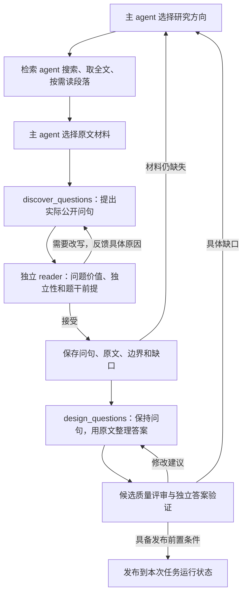

# 先把问题提出，再核对答案：真实模型实验与改造

## 目标

为检索动作选择器生成可独立提出的领域知识问题。读者无需知道生成时看过哪篇论文。问题应表达明确的信息需求，保留必要的物种、变异、疾病等领域条件；论文用作证据。允许简单查询，也允许多来源整合，不用人为复杂的题干代替检索价值。

例如，问两种变异的分子缺陷有何不同，以及两类药物如何针对这些缺陷；不问“某试验中的中位 PFS 是多少”，也不删除试验名后把该数字当作普遍属性。

## 发现的问题

1. 原设计把选题、题干和答案放在一次调用中，容易先摘出一个数字，再包装成问题。只修改总原则的两轮 EGFR 回放仍产生临床指标摘录或错误的分组归属。
2. “问题发现”如果只输出方向描述，实际作答阶段仍会另选一道更容易回答的题。
3. 只看问句的读者可以判断独立性，却发现不了“显著改善”被写成“接近正常”等无据前提。作答模型有时会替这个前提辩护。
4. 将详细机制猜测写成“是否因为……”容易制造伪信息需求；作答返回“原文未提及”不能算回答了这个机制问题。
5. 阅读工具每次最多四段的限制误用于出题材料组合，导致 TP53 重复选段失败。
6. 主 agent 把 `verify_answer` 的 `final_review` 当成 `review_candidate` 的质量评审，重复尝试发布。工具错误原先没有告诉它该调用哪个工具。

## 当前调用关系

问题发现内部最多两次提出/读者评审，不合格反馈到主 agent，不强迫保留题目。reader 收到问句、任务和原文，没有候选答案。原文只用于核对题干已经断言的前提，不要求在这一步写出答案。

新问题必须持有 `question-first-evidence-v2` 的 reader 接受记录。`objective_grounded_answer` 保持已接受问句，只写最小充分答案；材料不足可返回空候选和具体缺口。该程序约束只固定角色交接，不用关键词规则判断问题好坏。旧审批需要重新走发现环节；原有证据可继续使用。候选修订仍保留现有修订路径。

## 修改位置

- `generation/question_discovery.py`：实际 question 字段、reader 调用与反馈、保存评审及原文。
- `generation/question_design.py`：新问题进入独立作答角色；避免把原文同时放入 research_context 和 evidence_excerpts。
- `generation/research_tools.py`：交接已接受问句及评审范围；默认阅读仍四段/16,000字符。
- `generation/source_question_inputs.py`：选定出题材料合计预算32,000字符，引用仍按原文偏移和字节核对。
- `generation/react_main_agent.py`：新题交接前置条件、消除工具说明冲突、发布缺评审时明确调用 `review_candidate`。
- `llm/contracts.py`、`llm/prompts.py`：reader 与 grounded-answer 角色。
- `skills/objective-research-question-discovery/SKILL.md`：按对象、关系、区别和条件提出自然问题，避免从数字反编题目。
- `skills/objective-react-agent/SKILL.md`、`skills/objective-question-design/SKILL.md`、`skills/objective-candidate-review/SKILL.md`：领域问题的边界及角色协作。

## 真实模型观测

使用当前配置的 Qwen。实验根目录：`data/experiments/question-first-lab/`。每个运行保留逐步 before/after、debug_trace 中的发送消息与返回、prompt-and-output.md，以及来源。checkpoint 回放复用原始材料，不将旧模型答案当证据。

| 运行目录 | 观测 |
|---|---|
| `brca1-20261113-185055` | 新实体检索后生成 BRCA1–BARD1 如何影响 HR/NHEJ 修复选择的问题；原文支持 |
| `brca1-20261113-185714` | 同材料另一轮生成 BRCA1/PALB2/BRCA2/RAD51 损伤焦点形成层级问题；原文支持 |
| `cftr-20261113-185055` | 失败：题干把 ivacaftor 的改善写成接近正常 |
| `cftr-20261113-190112` | 生成 F508del/G551D 分子缺陷及 corrector/potentiator 对应关系；两份原文支持 |
| `cftr-20261113-190809` | 失败回归：单靠作答者自查仍为“接近正常”辩护 |
| `reader-premises-v2` | 新 reader 对照原文拒绝上述过强前提，同时接受缺陷/作用机制比较问句 |
| `cftr-20261113-191550` | 新版生成 ivacaftor 针对的缺陷与机制问题，独立原文诊断通过 |
| `tp53-20261113-191605` | 组合选段修复后生成小鼠骨肉瘤中接触突变与结构突变的转移/GOF比较；保留物种与模型条件，原文支持 |
| `egfr-20261113-191736` | 失败：详细机制猜测变成是非题；答案承认关键机制缺证据。增加问法与不足返回指导 |
| `brca1-20261113-191930` | 生成双等位 BRCA1 功能丧失的表型及范科尼贫血关联问题，原文诊断通过 |
| `cftr-20261113-192048` | 实际答案验证通过，但主 agent 混淆两种评审，重复尝试发布 |
| `cftr-20261113-192433` | 明确工具前置条件后补做候选评审，运行状态 COMPLETED，候选 PUBLISHED |
| `brca1-20261113-192529` | 完成正式答案验证与候选评审，运行状态 COMPLETED，候选 PUBLISHED |
| `ldlr-20261113-192735` | 从新实体检索到两篇全文，形成 LDLR 缺陷与 evinacumab 降脂机制的整合问题；旧进程再次混淆可验证与已验证状态 |
| `ldlr-20261113-193512` | 增加实际 publication_readiness 状态后，从已有候选继续，3步完成正式验证与发布，COMPLETED/PUBLISHED |
| `egfr-20261113-193531` | 失败保留：修订可以改变问句，但仍偏具体 Ki 数字，未完成发布；不能算合格产出 |

后续真实运行又修复两处交接问题：`publication_readiness.answer_verified` 由宿主根据实际 proposal/state 提供，与“允许进入验证”的 readiness 分开；无 proposal 的反馈列出 `verification_gap` 供模型读取。显式 `revision_of` 不再继承初次作答的问句锁定，修订后仍重新验证。新题的问句固定约束不变。

### 从头检索与交接回归

- `egfr-20261113-193938`：从实体重新检索，研究23步获得摘要和全文，转向核内EGFR。最终发布了“哪些癌症的生存率与核内EGFR表达负相关”的枚举题。人工复查不计为合格样例：其固定四项答案的完整性没有由领域范围证明，单篇综述列出的有限清单不能代替完整集合。
- `reader-scope-v2`：针对该真实反例，reader仍接受问句，解释为“非穷尽”。这说明问题可用性与答案集合完整性不可混为一谈；该回归未达到期望的拒绝结果，保留记录，不宣称规则已经解决。
- `egfr-20261113-194639`：复用已读段落后可直接发现机制问题；但宽泛地罗列激酶非依赖性功能导致盲答覆盖不同，未完成发布。后续指导强调多个联系共同解释一个具体现象，而非列完整的功能目录。
- `egfr-20261113-195314`：聚焦原则后的回放能形成正常细胞/肿瘤细胞DNA修复的比较问题，但跨条件机制外推仍需谨慎，且实际流程在盲答覆盖反馈与修订间继续运行，8个主动作内没有发布。不计合格产出，也不能据此声称所有EGFR问题已解决。

针对跨多个实体反复出现的 `source_sections` 漏填，`discover_questions` 现在在长材料未显式选段时，复用宿主阅读账本记录的已读段落，并从原始文件重新取文本；按原文offset排序，保留相同32,000字符总预算。显式选段优先；无已读段落时仍要求阅读/选择。不会使用模型摘要或自动补入未读段落。响应记录 `reused_read_material_ids`，可检查实际交接。

通过完整流程且人工保留的三个示例及其实际答案、来源，见实验根目录 `accepted-examples.json`。其他实验即便 runtime 标为 PUBLISHED，也不自动进入该样例文件。

本轮结论：已经做出可运行的“问题先行”路径，并在CFTR、BRCA1、LDLR上取得正式验证及实验发布结果；两篇全文的整合问题也能形成。该结论限于能力和这些具体样例，不是大规模稳定率的证明。后续最需要单独观察的是开放枚举的答案完整性、跨条件比较的推断强度，以及盲答覆盖不足时的修复效率。运行记录均保留，未提交git、未重启现有后端、未写生产题库。

部分早期 `--complete` 实验在任务完成后多推进一步而报 terminal 错误，已修实验脚本停止条件；以保存的运行状态和操作记录判断实际结果。实验发布只在隔离 runtime 中，不等于已导出生产页面的 questions.jsonl。

## 如何复查与继续

`run_live.py` 可 fresh entity 或 `--checkpoint` 回放；默认停在候选生成，`--complete` 继续运行正式评审和验证。`audit_candidates.py` 是另一次模型对照原文的诊断，不能当成金标准：已观察到审计模型把答案中的否定/缺证据说明读成正向断言。应同时读原文和实际验证记录。

这些样本证明新路径能生成所需类型，不能据此声称任何实体都稳定、每条答案都正确，或已证明 query-planner 的训练收益。还需观察更大样本的领域覆盖、重复率、证据足够程度和实际检索动作差异。问题质量、答案正确性、检索训练价值是三个不同判断。
